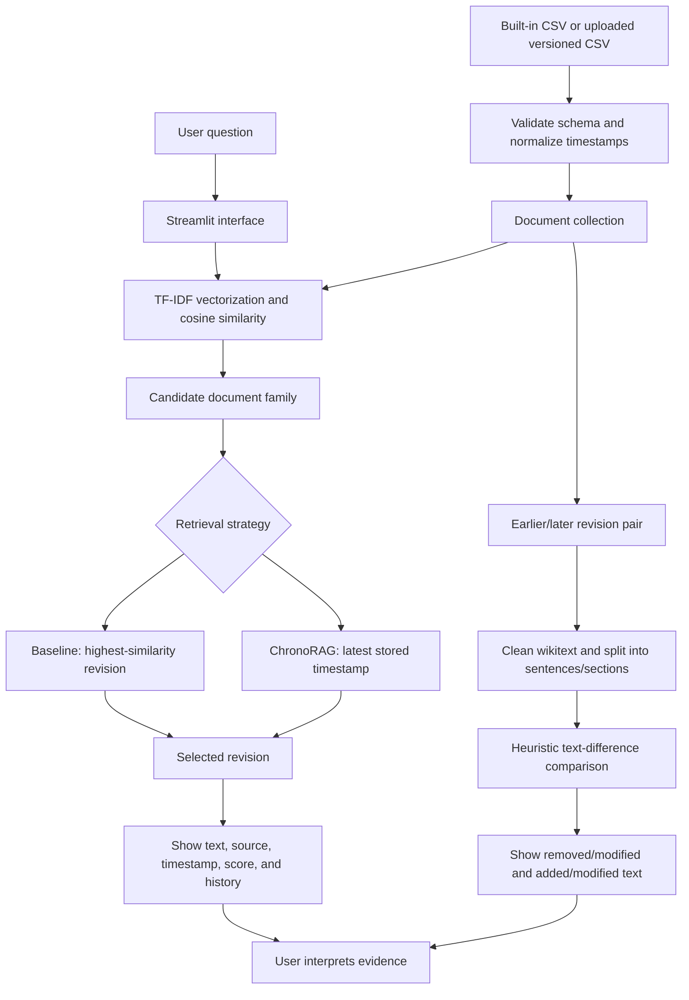

# ChronoRAG Architecture

## Component summary

- **Interface:** Streamlit controls for dataset, upload, retrieval strategy, and question.
- **Validation:** Requires `doc_id`, `title`, `version`, `effective_date`, `source`, and `text`; malformed rows are filtered or rejected with a message.
- **Retrieval baseline:** TF-IDF using unigrams/bigrams and cosine similarity.
- **Version-aware rule:** Uses the best matching family and selects its most recent stored timestamp.
- **Comparison:** Cleans basic Wikipedia markup, splits approximate sentences/sections, and reports text that differs.
- **Important boundary:** Comparison reports textual changes only; it does not prove semantic contradiction.
